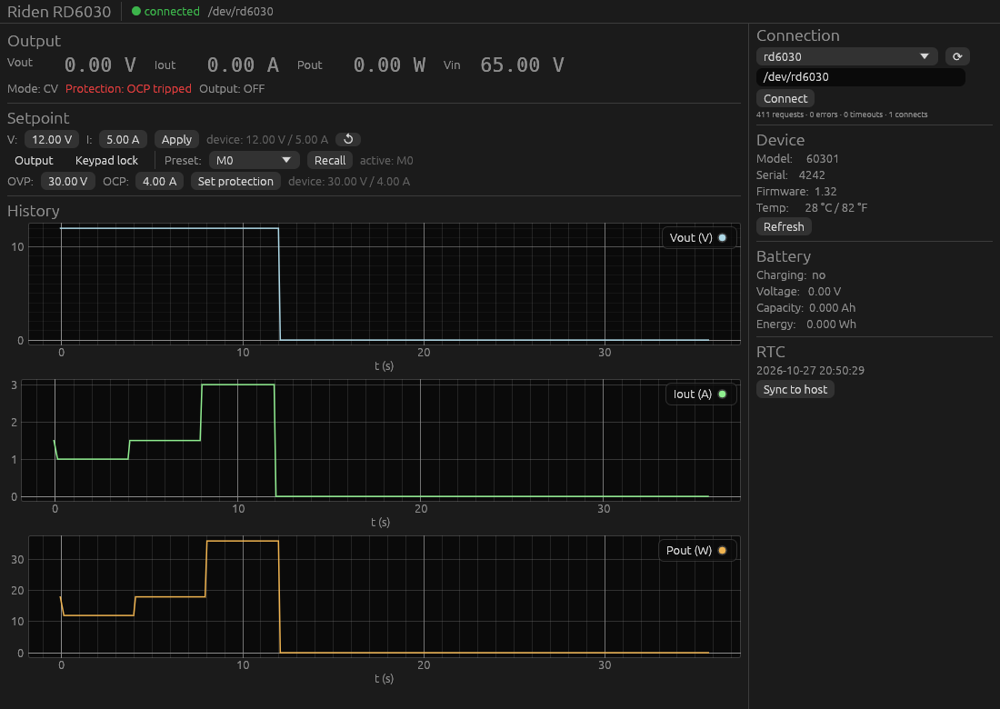
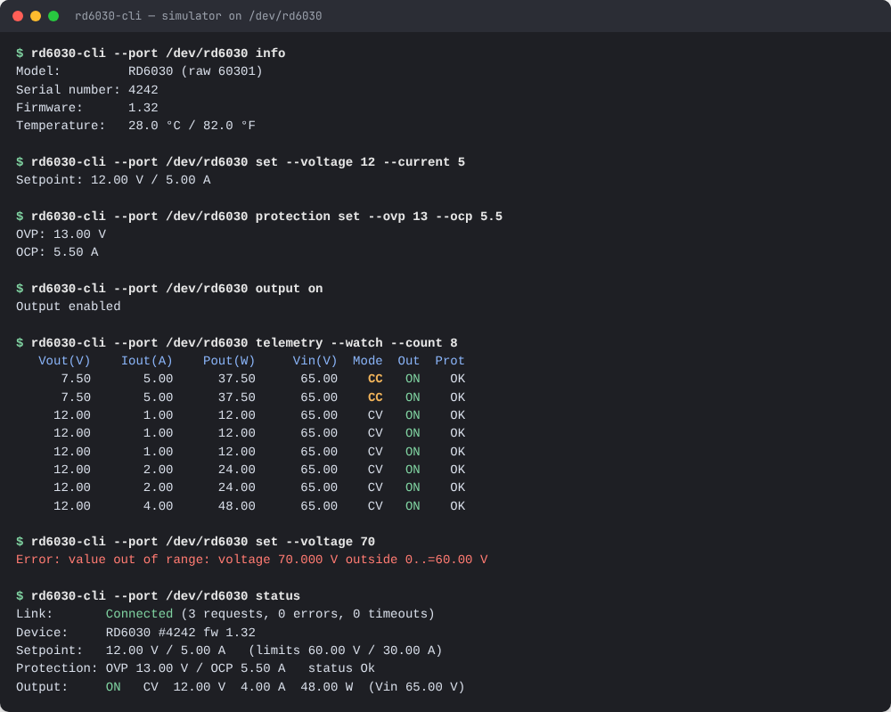
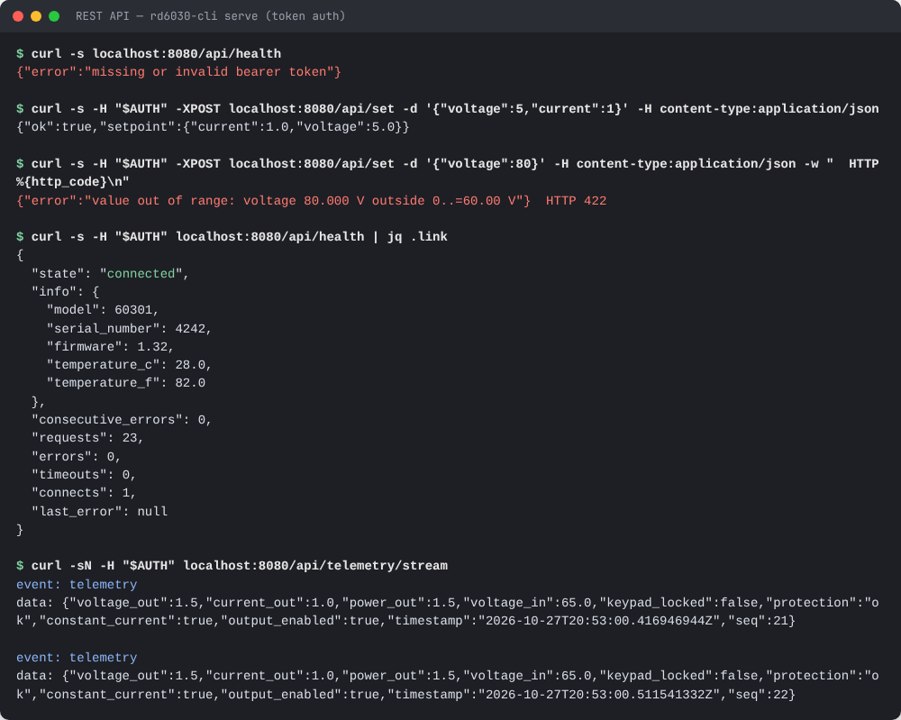
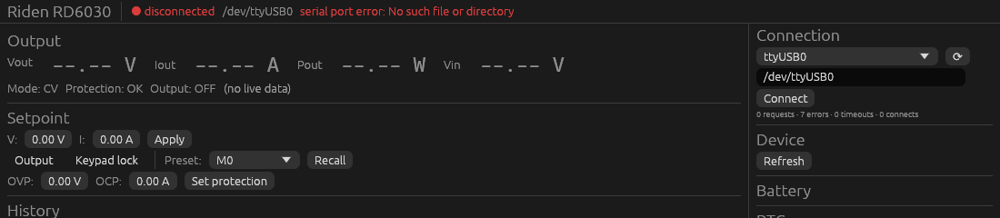
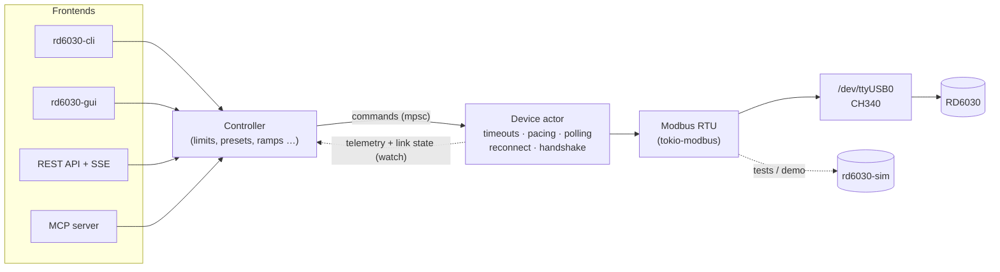

# powerSupplyControl

[](https://github.com/phil16021/powerSupplyControl/actions/workflows/ci.yml)
[](LICENSE)


**Control software for the Riden RD6030** programmable DC power supply (60 V / 30 A), written in
Rust. It talks to the supply over USB (CH340 UART bridge) using **Modbus RTU** and gives you:

- a scriptable **CLI** with `--json` output,
- a **REST API** with live telemetry over Server-Sent Events and bearer-token auth,
- an **MCP server**, so LLM clients such as Claude Desktop can operate the supply within your limits,
- a desktop **GUI** with live plots,
- a **simulator**, so all of the above can be run and tested without hardware.


<table>
<tr>
<td width="50%"><br><sub>Over-current protection trip: the output switches off and the status turns red.</sub></td>
<td width="50%"><br><sub>CLI: identity, setpoints, live CV/CC telemetry, limit enforcement.</sub></td>
</tr>
<tr>
<td width="50%"><br><sub>REST API: token auth, 422 on limit violations, health counters, SSE stream.</sub></td>
<td width="50%"><br><sub>No device? The GUI starts anyway, shows why, and reconnects in the background.</sub></td>
</tr>
</table>

<sub>All screenshots were taken against the built-in simulator (`rd6030-sim`).</sub>

## Contents

- [Quick start](#quick-start)
- [Features](#features)
- [Architecture](#architecture)
- [Installation](#installation) · [Linux setup](#linux-setup) · [Configuration](#configuration)
- [CLI](#cli) · [REST API](#rest-api) · [MCP](#mcp) · [GUI](#gui) · [Simulator](#simulator)
- [Testing](#testing) · [Troubleshooting](#troubleshooting)
- [Register reference](#register-reference) · [Safety notes](#safety-notes)

## Quick start

**Without hardware**, using the simulator:

```sh
cargo build --workspace --release
export PATH=$PWD/target/release:$PATH

rd6030-sim --link /tmp/rd6030 --load-ohms 10 &      # simulated RD6030 with a 10 Ω load
rd6030-cli --port /tmp/rd6030 set --voltage 12 --current 2
rd6030-cli --port /tmp/rd6030 output on
rd6030-cli --port /tmp/rd6030 status                # 12.00 V, 1.20 A, CV
```

**With an RD6030**, after the [Linux setup](#linux-setup):

```sh
rd6030-cli ports                                    # find the CH340 adapter
rd6030-cli --port /dev/ttyUSB0 status
rd6030-cli --port /dev/ttyUSB0 gui
```

The baud rate (default 115200) and slave address (default 1) must match the supply's settings menu.

## Features

**Control**
- Voltage and current setpoints, output on/off, keypad lock, gradual ramps.
- OVP/OCP thresholds, preset bank M0–M9 (recall, read/write, JSON export/import).
- RTC read/set/sync, battery-mode status, system options (buzzer, backlight).
- Calibration words and commit, behind explicit confirmation.

**Safety**
- **Software limits** (`[limits]`) that every front end obeys: CLI, REST, MCP and GUI.
- Optional *output off on exit* for unattended setups.
- Raw register writes are restricted to documented registers. The bootloader trigger (256) can never
  be written.
- Preset imports write only the slots that change, to limit EEPROM wear. Ramps touch only the
  volatile setpoints.
- REST: a token is required on non-loopback addresses, and calibration is off by default.

**Robustness**
- Every Modbus transaction has a timeout, so a silent device can't hang the software.
- After a transport error the port is reopened, which re-syncs framing. Reconnects back off
  exponentially, so unplugging and replugging USB just works.
- A published link state and counters (requests, errors, timeouts, reconnects).
- 10–20 Hz polling with timestamped, sequence-numbered samples. Stale data is never shown as live.
- A minimum gap between frames protects the device MCU, and polling stays fair under command floods.

**Observability**
- CSV / JSON Lines logging (new samples only, with device timestamps).
- `RUST_LOG=rd6030_core=trace` prints a hex dump of every frame.

## Architecture



A single actor task owns the serial port and serializes every request. Front ends talk to it
through a cloneable `Controller` and receive telemetry and link state over `watch` channels.

| Crate | Purpose |
|-------|---------|
| `rd6030-core` | Register map, scaling, models, actor driver, controller, logging |
| `rd6030-cli` | Command-line interface (also starts `serve`, `mcp` and `gui`) |
| `rd6030-server` | REST API (axum) and MCP server (rmcp, stdio and streamable HTTP) |
| `rd6030-gui` | egui/eframe desktop GUI |
| `rd6030-sim` | Behavioural RD6030 simulator on a PTY or an in-memory stream |

## Installation

Prerequisites: Rust **1.95+** and, on Linux, `libudev-dev`, `pkg-config` and the GUI libraries
(`libxkbcommon-dev`, `libgl1-mesa-dev`, `libwayland-dev`, `libx11-dev`).

```sh
sudo apt install libudev-dev pkg-config libxkbcommon-dev libgl1-mesa-dev libwayland-dev libx11-dev
cargo build --workspace --release
sudo install -m 0755 target/release/rd6030-{cli,server,gui,sim} /usr/local/bin/
```

## Linux setup

1. **Permissions.** Add yourself to `dialout` (`sudo usermod -aG dialout $USER`, then log in again),
   or install the udev rule.
2. **udev rule.** It creates a stable `/dev/rd6030` symlink and keeps ModemManager off the port:
   ```sh
   sudo cp packaging/99-rd6030.rules /etc/udev/rules.d/
   sudo udevadm control --reload-rules && sudo udevadm trigger
   ```
3. **Ubuntu: brltty.** The `brltty` package claims CH340 adapters, and `/dev/ttyUSB0` vanishes
   right after plugging in. Remove it with `sudo apt remove brltty` if you don't use a braille display.
4. **Service (optional).** [`packaging/rd6030-server.service`](packaging/rd6030-server.service) runs
   the REST/MCP server under systemd. It starts even when the supply is unplugged.

> The serial port is opened **exclusively**, so only one process can talk to the supply at a time.
> To share it, run `rd6030-cli serve` and point every client at the REST API or MCP.

## Configuration

Every field is optional; [`config.example.toml`](config.example.toml) documents them all. Lookup
order: `--config PATH` → `$RD6030_CONFIG` → `./config.toml` →
`$XDG_CONFIG_HOME/rd6030/config.toml` → built-in defaults. An explicitly named file must exist.

```toml
port = "/dev/rd6030"
baud_rate = 115200       # must match the device menu
slave_id = 1
timeout_ms = 500         # per transaction, >= 300
poll_interval_ms = 100   # 10 Hz

[limits]                 # protect your device under test
max_voltage = 24.0
max_current = 5.0

[safety]
output_off_on_exit = true

[server]
host = "127.0.0.1"       # non-loopback addresses require `token`
port = 8080
# token = "change-me"
```

## CLI


| Task | Command |
|------|---------|
| Find the adapter | `rd6030-cli ports` |
| Overview | `rd6030-cli status` |
| Identity | `rd6030-cli info` |
| Live values | `rd6030-cli telemetry --watch [--count N]` |
| Setpoints | `rd6030-cli set --voltage 12 --current 2.5` |
| Output | `rd6030-cli output on\|off` |
| Ramp | `rd6030-cli ramp --voltage 24 --step 0.5 --interval-ms 100` |
| Protection | `rd6030-cli protection get` / `set --ovp 13 --ocp 3` |
| Keypad | `rd6030-cli lock on\|off` |
| Presets | `rd6030-cli preset select 2` · `preset read 2` · `preset write 2 --voltage 5 --current 1 --ovp 6 --ocp 1.5` |
| Preset backup | `rd6030-cli preset export --file presets.json` · `preset import presets.json` |
| Clock | `rd6030-cli rtc get\|sync` |
| Battery mode | `rd6030-cli battery` |
| Options | `rd6030-cli system get` · `system buzzer off` · `system backlight 3` |
| Logging | `rd6030-cli log --path run.csv --interval-ms 200` (`.jsonl` for JSON Lines) |
| Debugging | `rd6030-cli raw read 0 20` |
| Servers / GUI | `rd6030-cli serve` · `rd6030-cli mcp` · `rd6030-cli gui` |

Global options: `--port`, `--baud`, `--slave`, `--config` and `--json` (machine-readable output for
scripts). Dangerous operations require `--yes`: `calibrate write`, `calibrate commit` and
`raw write`.

```sh
# Scripting example: wait until the output settles in CV mode
until [ "$(rd6030-cli --json telemetry | jq .constant_current)" = false ]; do sleep 0.5; done
```

## REST API

Start the server with `rd6030-cli serve` (or `rd6030-server serve`). When `server.token` is set,
every request needs `Authorization: Bearer <token>`. The same check covers `/mcp`.


| Method | Path | Body / description |
|--------|------|--------------------|
| GET | `/api/health` | Link state, counters, telemetry age |
| GET | `/api/info` | Identity, firmware, temperatures |
| GET | `/api/telemetry` | Latest sample (`seq`, `timestamp`, values) |
| GET | `/api/telemetry/stream` | Server-Sent Events, one `telemetry` event per sample |
| POST | `/api/output` | `{"enabled": true}` |
| POST | `/api/set` | `{"voltage": 12.0, "current": 2.0}` (either or both) |
| GET | `/api/setpoint` | Active setpoint |
| POST | `/api/ramp` | `{"voltage": 24, "step": 0.5, "interval_ms": 100}` |
| GET | `/api/limits` | Software limits |
| GET/PUT | `/api/protection` | `{"ovp": 13.0, "ocp": 3.0}` |
| GET/PUT | `/api/lock` | `{"locked": true}` |
| GET | `/api/options` | System options |
| GET | `/api/presets` | Active slot and setpoint |
| POST | `/api/presets/select` | `{"slot": 2}` |
| GET/PUT | `/api/presets/bank` | Export / import all slots |
| GET/PUT | `/api/presets/{slot}` | `{"voltage", "current", "ovp", "ocp"}` |
| GET | `/api/battery` | Battery-mode status |
| GET/PUT | `/api/rtc` | Read / set the RTC (validated) |
| POST | `/api/rtc/sync` | Sync the RTC to the host clock |
| POST | `/api/calibrate/commit` | `{"confirm": true}`, only with `allow_calibration = true` |

Errors return `{"error": "…"}` with one of these statuses:

| Status | Meaning |
|--------|---------|
| 400 | Bad request |
| 401 | Missing or invalid token |
| 403 | Forbidden |
| 422 | Out of range or over a limit |
| 502 | Device or protocol error |
| 503 | Not connected |
| 504 | Timeout |

## MCP

Use the supply from Claude Desktop or any other MCP client. Over stdio, logs go to stderr, so
stdout carries only the protocol:

```json
{
  "mcpServers": {
    "rd6030": { "command": "rd6030-cli", "args": ["--port", "/dev/rd6030", "mcp"] }
  }
}
```

The streamable-HTTP transport is mounted at `/mcp` on the REST server.

| Tools | |
|-------|---|
| Read | `get_telemetry`, `get_device_info`, `get_status`, `get_limits`, `get_setpoint`, `get_protection`, `read_preset`, `get_battery`, `get_rtc` |
| Act | `set_voltage`, `set_current`, `set_setpoint`, `set_output`, `ramp_voltage`, `set_protection`, `select_preset`, `sync_rtc` |

The software limits apply to every tool. Calibration, raw register access and preset-bank writes are
not exposed. Errors come back as readable tool errors, so the model can correct itself.

## GUI

`rd6030-gui`, or `rd6030-cli gui`, which forwards `--config/--port/--baud/--slave`.

- Starts without a device. A port picker and a link indicator show *connected*, *degraded* or
  *disconnected* along with the last error.
- Large live readouts that show `--.--` when the data is stale, CV/CC mode, and protection trips in red.
- Editors for the setpoint and OVP/OCP, with the device's current values next to them, re-read every
  2 s so front-panel changes show up.
- Preset recall, keypad lock, RTC sync, device and battery info.
- V / I / P plots over the last 120 s on a shared time axis.

## Simulator

`rd6030-sim` serves a behavioural RD6030 on a pseudo-terminal:

```sh
rd6030-sim --link /tmp/rd6030 --load-ohms 10               # fixed 10 Ω load
rd6030-sim --link /tmp/rd6030 --load-cycle 12,4,1.5 --cycle-secs 3   # step the load (CV ↔ CC)
```

It models:
- CV/CC regulation into the load,
- OVP/OCP trips: the output switches off, and switching it on again clears the trip,
- preset recall,
- the RTC and system options,
- Modbus exceptions for illegal addresses or writes to read-only registers.

Frames with a bad CRC, or addressed to another slave id, are ignored as on a real bus. The test suites
use the same simulator in-process.

## Testing

```sh
cargo fmt --all --check
cargo clippy --workspace --all-targets -- -D warnings
cargo test --workspace
```

| Level | What | Where |
|-------|------|-------|
| Unit | Scaling, register policy, config discovery, RTC validation, limits, ramps, logger | `src/*` |
| Actor | Timeouts, reconnect/back-off, link state, pacing, polling fairness (paused time, fault-injecting `MockBackend`) | `rd6030-core/src/driver.rs` |
| Protocol | Real tokio-modbus RTU client over a duplex **and a PTY**; recovery from exceptions, bad CRC, silence | `rd6030-core/tests/e2e_loopback.rs` |
| Server | REST and MCP against the simulator (auth, status codes, tools) | `rd6030-server/tests/server.rs` |
| CLI | The real binary against the simulator on a PTY | `rd6030-cli/tests/cli.rs` |
| Hardware | `#[ignore]`d HIL suite, needs `RD6030_PORT` | `rd6030-core/tests/hil.rs`, [`docs/hil.md`](docs/hil.md) |

CI runs fmt, clippy, the tests and a release build on every push.

To run the hardware suite on a real supply (disconnect any load first):

```sh
RD6030_PORT=/dev/rd6030 cargo test -p rd6030-core --test hil -- --ignored --test-threads=1
```

## Troubleshooting

| Symptom | Likely cause / fix |
|---------|--------------------|
| `device did not respond within 500ms` on every request | Baud rate or slave id differs from the device menu, wrong port, or brltty |
| `Unable to acquire exclusive lock` / `EBUSY` | Another process (GUI, server, ModemManager) holds the port |
| `/dev/ttyUSB0` vanishes right after plugging in | brltty claimed the CH340, see [Linux setup](#linux-setup) |
| `Permission denied` | Not in `dialout`, or the udev rule is not installed |
| Occasional CRC errors or timeouts | Poll interval too short or a poor USB cable; the driver recovers on its own |
| `unsupported device model id` | Not an RD6030 (e.g. an RD6006P scales differently); `allow_unknown_model` overrides |
| Output never reaches the setpoint | Vset is above Vin / 1.1 (a warning is logged), or the supply is in CC mode |

Debugging aids:
- `RUST_LOG=rd6030_core=debug` shows link transitions; `=trace` adds a hex dump of every frame.
- `rd6030-cli status` and `GET /api/health` show the request, error, timeout and connect counters.
- To sniff traffic, run the simulator and put `socat -x -v` between two PTYs.

## Register reference

32-bit values span two registers, high word first (big-endian). Entries marked † come from the
community register map (Baldanos/rd6006, riden-dongle) and are queued for hardware verification in
[`docs/hil.md`](docs/hil.md).

| Address | Register | Scale | Access |
|---------|----------|-------|--------|
| 0 | Model id (`60301` = RD6030; model = raw / 10) | raw | R |
| 1–2 | Serial number | u32 | R |
| 3 | Firmware version | ×100 | R |
| 4–7 | Internal temperature °C / °F (sign + value) | 1° | R |
| 8 / 9 | Vset / Iset | 10 mV / 10 mA | R/W |
| 10 / 11 | Vout / Iout | 10 mV / 10 mA | R |
| 12–13 | Pout | u32, 10 mW | R |
| 14 | Vin | 10 mV | R |
| 15 | Keypad lock | 0/1 | R/W |
| 16 | Protection (0 OK, 1 OVP, 2 OCP) | — | R |
| 17 | CV/CC (0 CV, 1 CC) | — | R |
| 18 | Output enable | 0/1 | R/W |
| 19 | Preset recall (M0–M9) | 0–9 | R/W |
| 32–41 | Battery mode, Vbat, ext. temperature, capacity (mAh), energy (mWh †) | mixed | R |
| 48–53 | RTC (year, month, day, hour, minute, second) | — | R/W |
| 54 | Calibration commit `0x1501` † (unverified) | — | W |
| 55–62 | Calibration words (V/I out/back zero/scale) † | raw | R/W |
| 66–72 | Options: take-ok, take-out, boot power, buzzer, logo, language, backlight † | raw | R/W |
| 80 + 4·n | Preset Mn: V, I, OVP, OCP (M0 = active OVP/OCP) † | 10 mV / 10 mA | R/W |
| 256 | Bootloader trigger: **never written** by this software | — | — |

## Safety notes

- The host is the Modbus **master**; the RD6030 is the slave.
- Keep polling at 10–20 Hz. The driver also enforces a minimum gap between transactions.
- Setpoints (registers 8/9) are volatile. Presets, OVP/OCP, options and calibration live in
  EEPROM/flash with limited write endurance. Never write them from loops; `ramp` touches only the
  volatile setpoints.
- Set `[limits]` to what your device under test can tolerate, and enable `output_off_on_exit` for
  unattended operation.
- This software is not a safety device. Use the supply's own OVP/OCP for hardware protection.

## License

[GPL-2.0-or-later](LICENSE)
