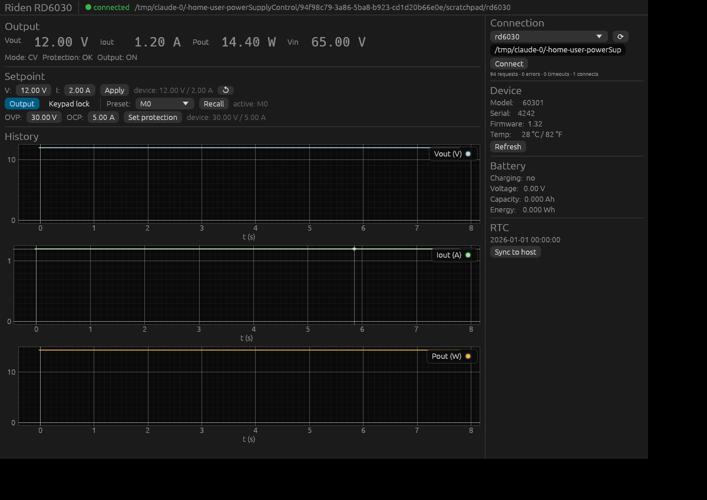

# powerSupplyControl

Control software for the **Riden RD6030** programmable DC power supply (60 V / 30 A), written
entirely in Rust. It talks to the device over USB (CH340 UART bridge) using **Modbus RTU** and
offers a CLI, a REST API, an MCP server (for LLM clients) and an egui GUI. A behavioural simulator
lets you run and test everything without hardware.



## Workspace layout

| Crate | Kind | Purpose |
|-------|------|---------|
| `rd6030-core` | library | Register map, scaling, typed models, actor driver (timeouts, reconnect, pacing), controller with software limits, presets/protection/RTC/battery/system/calibration, telemetry logging |
| `rd6030-cli` | binary | Command-line interface (also dispatches `serve`/`mcp`/`gui`) |
| `rd6030-server` | lib + binary | REST API (axum) with SSE, bearer-token auth, and an MCP server (`rmcp`, stdio + streamable HTTP) |
| `rd6030-gui` | binary | egui/eframe desktop GUI: live values, plots, controls, link indicator, port picker |
| `rd6030-sim` | lib + binary | Simulated RD6030 (CV/CC into a resistive load, OVP/OCP trips, presets) on a PTY or an in-memory stream |

## Features

- Identity (model, serial, firmware), temperatures, live telemetry (Vout, Iout, Pout, Vin, CV/CC,
  protection, output, keypad lock) polled in the background at 10–20 Hz with sample timestamps and
  sequence numbers.
- Voltage/current setpoints (volatile registers 8/9), output on/off, keypad lock, gradual **ramps**.
- **Software limits** (`[limits]`) enforced for every front end. The CLI, REST, MCP and GUI cannot
  exceed them.
- **OVP/OCP** thresholds, preset bank **M0–M9** read/write/export/import as JSON. Only changed slots
  are written, to limit EEPROM wear.
- RTC read/set/sync, battery-mode status, system options (buzzer, backlight).
- Calibration words (55..=62) and commit, guarded by explicit confirmation and disabled on the server
  by default.
- Robust driver: every request has a timeout, the port is reopened after transport errors, reconnects
  back off exponentially, the link state is published, transactions are paced, and polling stays fair
  under command load.
- Raw register access for debugging, with a write allowlist. Register 256, the bootloader trigger, is
  never writable.
- CSV / JSON Lines telemetry logging (only new samples, with device timestamps).

## Building

Prerequisites: Rust **1.95+** (tested with 1.97) and, on Linux, `libudev-dev` plus
the usual GUI libraries (`libxkbcommon-dev`, `libgl1-mesa-dev`, `libwayland-dev`, `libx11-dev`).

```sh
cargo build --workspace --release
```

The binaries land in `target/release/`: `rd6030-cli`, `rd6030-server`, `rd6030-gui`, `rd6030-sim`.

## Linux setup

1. **Permissions.** Add yourself to `dialout` (`sudo usermod -aG dialout $USER`, then log in again),
   or install the udev rule below.
2. **udev rule.** It gives a stable `/dev/rd6030` symlink and keeps ModemManager away from the port:
   ```sh
   sudo cp packaging/99-rd6030.rules /etc/udev/rules.d/
   sudo udevadm control --reload-rules && sudo udevadm trigger
   ```
3. **Ubuntu: brltty.** The `brltty` package claims CH340 adapters, and `/dev/ttyUSB0` disappears
   right after plugging in. Remove it (`sudo apt remove brltty`) if you don't use a braille display.
4. **Service (optional).** `packaging/rd6030-server.service` runs the REST/MCP server under systemd.

The port is opened **exclusively**. Only one process (CLI, GUI or server) can talk to the device at a
time. To share it between several clients, run `rd6030-cli serve` and use the REST API or MCP.

## Configuration

All fields are optional. See [`config.example.toml`](config.example.toml) for the full list. Lookup
order: `--config PATH` → `$RD6030_CONFIG` → `./config.toml` →
`$XDG_CONFIG_HOME/rd6030/config.toml` → built-in defaults. An explicitly named file must exist.

```toml
port = "/dev/rd6030"
baud_rate = 115200      # must match the device menu
slave_id = 1
timeout_ms = 500
poll_interval_ms = 100

[limits]
max_voltage = 24.0      # protect your DUT
max_current = 5.0

[safety]
output_off_on_exit = true

[server]
host = "127.0.0.1"      # non-loopback requires `token`
port = 8080
# token = "change-me"
```

## CLI

```sh
rd6030-cli ports                                  # find the CH340 port
rd6030-cli --port /dev/rd6030 status              # link, setpoint, protection, output
rd6030-cli info
rd6030-cli telemetry --watch [--count 10]
rd6030-cli set --voltage 12.0 --current 2.5
rd6030-cli output on
rd6030-cli ramp --voltage 24 --step 0.5 --interval-ms 100
rd6030-cli protection set --ovp 13 --ocp 3
rd6030-cli lock on
rd6030-cli preset select 2
rd6030-cli preset export --file presets.json      # edit, then:
rd6030-cli preset import presets.json             # writes only changed slots
rd6030-cli rtc sync
rd6030-cli battery
rd6030-cli system backlight 3
rd6030-cli log --path telemetry.csv --interval-ms 200
rd6030-cli raw read 0 20                          # debugging
rd6030-cli --json telemetry                       # machine-readable output
```

Dangerous operations need an explicit `--yes`: `calibrate write`, `calibrate commit` and
`raw write`.

## REST API

Start it with `rd6030-cli serve` (or `rd6030-server serve`). When `server.token` is set, every request
needs `Authorization: Bearer <token>`.

| Method | Path | Description |
|--------|------|-------------|
| GET | `/api/health` | Link state, driver statistics, telemetry age |
| GET | `/api/info` | Identity, serial, firmware, temperatures |
| GET | `/api/telemetry` | Latest sample (`seq`, `timestamp`, values) |
| GET | `/api/telemetry/stream` | Server-sent events, one `telemetry` event per sample |
| POST | `/api/output` | `{"enabled": bool}` |
| POST | `/api/set` | `{"voltage": f32?, "current": f32?}` |
| GET | `/api/setpoint` | Active setpoint |
| POST | `/api/ramp` | `{"voltage"\|"current": f32, "step": f32, "interval_ms": u64}` |
| GET | `/api/limits` | Software limits |
| GET/PUT | `/api/protection` | `{"ovp": f32, "ocp": f32}` |
| GET/PUT | `/api/lock` | `{"locked": bool}` |
| GET | `/api/options` | System options |
| GET | `/api/presets` | Active slot and setpoint |
| POST | `/api/presets/select` | `{"slot": 0..9}` |
| GET/PUT | `/api/presets/bank` | Export / import all slots |
| GET/PUT | `/api/presets/{slot}` | One slot `{"voltage","current","ovp","ocp"}` |
| GET | `/api/battery` | Battery-mode status |
| GET/PUT | `/api/rtc` | Read / set the RTC (validated) |
| POST | `/api/rtc/sync` | Sync to the host clock |
| POST | `/api/calibrate/commit` | `{"confirm": true}`, only with `server.allow_calibration = true` |

Errors are `{"error": "..."}` with these status codes: 400 bad request, 401 missing token,
403 forbidden, 422 out of range or limit, 502 device/protocol error, 503 not connected, 504 timeout.

```sh
curl -s localhost:8080/api/health | jq
curl -s -XPOST localhost:8080/api/set -H 'content-type: application/json' -d '{"voltage":5,"current":1}'
curl -N localhost:8080/api/telemetry/stream
```

## MCP

Run the MCP server over stdio (Claude Desktop / IDEs). Logs go to stderr, so stdout carries only the
protocol:

```json
{ "mcpServers": { "rd6030": { "command": "rd6030-cli", "args": ["--port", "/dev/rd6030", "mcp"] } } }
```

The streamable-HTTP endpoint is mounted at `/mcp` on the REST server (same token). Tools:
`get_telemetry`, `get_device_info`, `get_status`, `get_limits`, `get_setpoint`, `set_voltage`,
`set_current`, `set_setpoint`, `set_output`, `ramp_voltage`, `get_protection`, `set_protection`,
`read_preset`, `select_preset`, `get_battery`, `get_rtc`, `sync_rtc`. The software limits apply.
Calibration, raw access and preset-bank writes are not exposed.

## GUI

`rd6030-cli gui` (forwards `--config/--port/--baud/--slave`) or `rd6030-gui`. The GUI starts without
a device and connects in the background. A port picker lets you switch ports. It shows live values
(`--.--` when stale), protection trips, setpoint/OVP/OCP editors (with the current device values next
to them, re-read every 2 s), preset recall, keypad lock, and V/I/P plots over the last 120 s.

## Simulator

```sh
rd6030-sim --link /tmp/rd6030 --load-ohms 10 &
rd6030-cli --port /tmp/rd6030 set --voltage 12 --current 2
rd6030-cli --port /tmp/rd6030 output on
rd6030-cli --port /tmp/rd6030 status        # 12.00 V, 1.20 A, CV
```

The simulator models CV/CC into the load, OVP/OCP trips (output off, cleared when the output is
switched on again), preset recall and Modbus exceptions for illegal addresses or read-only writes.

## Testing

```sh
cargo fmt --all --check
cargo clippy --workspace --all-targets -- -D warnings
cargo test --workspace
```

| Level | Where |
|-------|-------|
| Unit: scaling, register policy, config discovery, RTC validation, limits, ramps, logger | `src/*` in each crate |
| Actor: timeouts, reconnect/back-off, link state, pacing, polling fairness (paused time, fault-injecting `MockBackend`) | `rd6030-core/src/driver.rs` |
| Protocol e2e: real tokio-modbus RTU client against a slave over duplex **and a PTY**; exception, bad CRC and silence recovery | `rd6030-core/tests/e2e_loopback.rs` |
| REST + MCP against the simulator | `rd6030-server/tests/server.rs` |
| CLI binary against the simulator on a PTY | `rd6030-cli/tests/cli.rs` |
| Hardware-in-the-loop (`#[ignore]`, needs `RD6030_PORT`) | `rd6030-core/tests/hil.rs`, checklist in [`docs/hil.md`](docs/hil.md) |

CI (`.github/workflows/ci.yml`) runs fmt, clippy, the tests and a release build.

## Debugging and troubleshooting

- `RUST_LOG=rd6030_core=debug` shows link transitions. `RUST_LOG=rd6030_core=trace` adds a hex dump
  of every frame (`serial tx` / `serial rx`).
- `rd6030-cli status` / `GET /api/health` show request, error, timeout and connect counters.
- Sniff frames by running the simulator and putting `socat -x -v` between two PTYs.

| Symptom | Likely cause |
|---------|--------------|
| `device did not respond within 500ms` on every request | Baud rate or slave id differs from the device menu; wrong port; brltty |
| `Unable to acquire exclusive lock` / `EBUSY` | Another process (GUI, server, ModemManager) holds the port |
| `/dev/ttyUSB0` vanishes right after plugging in | brltty (Ubuntu) claimed the CH340, see Linux setup |
| `Permission denied` | Not in `dialout`, or the udev rule is not installed |
| Occasional CRC/timeout errors | Poll interval too short, poor USB cable; the driver recovers automatically |
| `unsupported device model id` | Not an RD6030 (e.g. RD6006P with different scaling); `allow_unknown_model` overrides |
| Output does not reach the voltage setpoint | Vset > Vin / 1.1 (a warning is logged) or CC mode |

## Register reference

32-bit values combine two consecutive registers in **big-endian** order (high word at the lower
address). Entries marked † are taken from the community register map (Baldanos/rd6006,
riden-dongle) and are listed for hardware verification in [`docs/hil.md`](docs/hil.md).

| Address | Register | Scale | Access |
|---------|----------|-------|--------|
| 0 | Model id (`60301` = RD6030; model = raw / 10) | raw | R |
| 1–2 | Serial number | u32 | R |
| 3 | Firmware version | ×100 | R |
| 4–7 | Internal temperature °C / °F (sign + value) | 1° | R |
| 8 / 9 | Vset / Iset | 10 mV / 10 mA | R/W |
| 10 / 11 | Vout / Iout | 10 mV / 10 mA | R |
| 12–13 | Pout | u32, 10 mW | R |
| 14 | Vin | 10 mV | R |
| 15 | Keypad lock | 0/1 | R/W |
| 16 | Protection (0 OK, 1 OVP, 2 OCP) | — | R |
| 17 | CV/CC (0 CV, 1 CC) | — | R |
| 18 | Output enable | 0/1 | R/W |
| 19 | Preset recall (M0–M9) | 0–9 | R/W |
| 32–41 | Battery mode, Vbat, ext. temperature, capacity (mAh), energy (mWh †) | mixed | R |
| 48–53 | RTC (year, month, day, hour, minute, second) | — | R/W |
| 54 | Calibration commit `0x1501` † (unverified) | — | W |
| 55–62 | Calibration words (V/I out/back zero/scale) † | raw | R/W |
| 66–72 | System options: take-ok, take-out, boot power, buzzer, logo, language, backlight † | raw | R/W |
| 80 + 4·n | Preset Mn: V, I, OVP, OCP (M0 = active OVP/OCP) † | 10 mV / 10 mA | R/W |
| 256 | Bootloader trigger: **never written** by this software | — | — |

## Safety notes

- The host is the Modbus **master**; the RD6030 is the slave.
- Keep polling at 10–20 Hz. The driver also leaves a minimum gap between transactions.
- Setpoints (8/9) are volatile. Presets, OVP/OCP, system options and calibration are stored in
  EEPROM/flash with limited write endurance. Never write them from sweep or ramp loops; `ramp` uses
  only registers 8/9.
- Set `[limits]` to what your device under test tolerates, and enable `output_off_on_exit` for
  unattended setups.

## License

[GPL-2.0-or-later](LICENSE).
